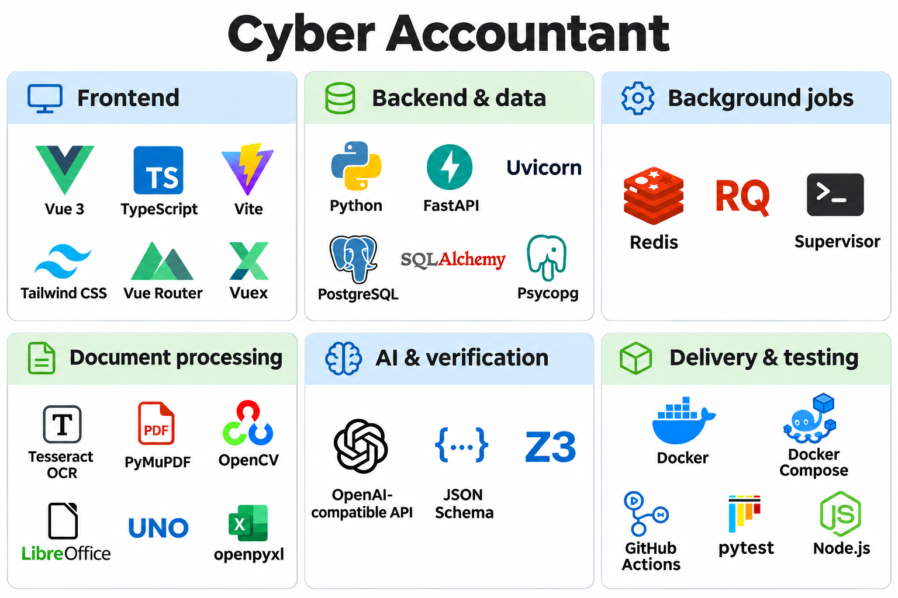
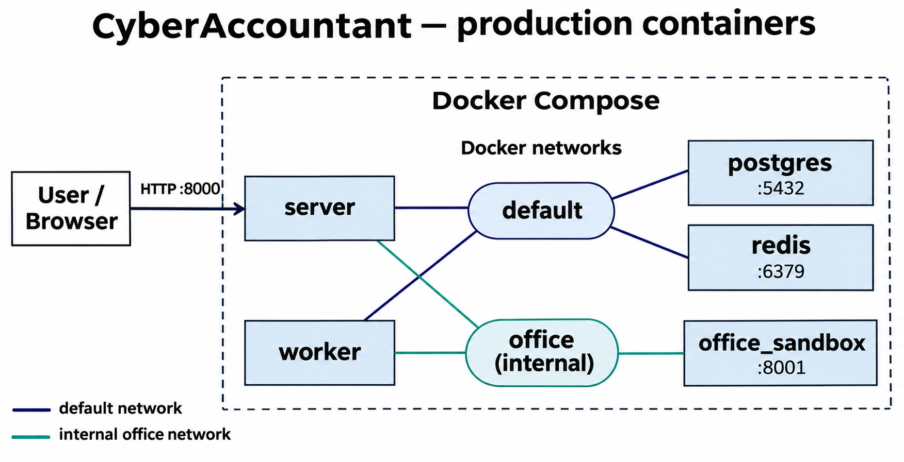

# Cyber Accountant

Cyber Accountant — система проверки карточки учёта фактических затрат (КФЗ) по первичным и расчётным документам. Она
извлекает показатели и реквизиты, связывает документы, рассчитывает ожидаемые значения и показывает расхождения с
подтверждающими фрагментами. Если данных недостаточно, показатель остаётся непроверенным.

В основе решения — сочетание LLM для понимания документов, детерминированных алгоритмов для известных форм и
математического решателя Z3 для проверки ограничений. Бухгалтер может проверить и исправить распознанный текст, сущности
и ограничения перед получением результата.

[Сценарии использования](docs/USECASES.md)

## Содержание

- [Как устроена проверка](#как-устроена-проверка)
    - [Подготовка документов](#подготовка-документов)
    - [Выделение сущностей](#выделение-сущностей)
    - [Генерация ограничений](#генерация-ограничений)
    - [Проверка ограничений](#проверка-ограничений)
- [Итоговый отчёт](#итоговый-отчёт)
- [Неполные данные и ошибки](#неполные-данные-и-ошибки)
- [Данные и конфиденциальность](#данные-и-конфиденциальность)
- [Архитектура и инфраструктура](#архитектура-и-инфраструктура)
- [Запуск](#запуск)
    - [Требования и настройки](#требования-и-настройки)
    - [Разработка](#разработка)
    - [Prod](#prod)
- [Проверки и CI](#проверки-и-ci)

## Как устроена проверка

### Подготовка документов

На вход подаются PDF, DOCX, XLSX, PNG и JPEG, в том числе сканы. Максимальный размер одного файла — 20 МБ. Алгоритм
преобразует документы к стандартизированному Markdown-представлению, сохраняя таблицы и разметку, необходимую для
дальнейшей проверки.

Дополнительно подготавливается PDF для отображения файла на стороне клиента. Координаты текста в PDF связываются с
Markdown. Это позволяет перейти от сущности к конкретному фрагменту документа и подсветить его.

Формулы в XLSX пересчитываются через LibreOffice перед преобразованием. Для обработки Office-файлов используется
отдельный контейнер `office_sandbox` с минимальными привилегиями и без доступа во внешнюю сеть.

После обработки пользователь может вручную скорректировать распознанный текст. В редакторе одновременно видны исходный
документ и Markdown.

### Выделение сущностей

На вход поступают Markdown-файлы. В них выделяются **сущности** — конкретные суммы, числа, даты, периоды, номера
документов и договоров. Каждая сущность получает идентификатор (`#0`, `#1`, ...), тип, единицу измерения,
нормализованное значение и ссылку на исходный фрагмент.

Для выделения сущностей по умолчанию используется `deepseek/deepseek-v4.1-flash-20261017` с настройкой reasoning
`disabled`. Выход модели дополнительно проверяется: например, алгоритм контролирует, что разметка не изменила исходный
текст.

Суммы приводятся к нормализованным значениям с учётом множителя единицы измерения. Даты и периоды представляются
границами интервала.

Полученные сущности отображаются пользователю, и он может их отредактировать. Дальнейшие проверки используют только
сущности, поэтому если нам не надо проверять показатель, то мы просто исключаем его из сущностей и система его не
учитывает.

### Генерация ограничений

Каждый генератор принимает документы с размеченными сущностями и выдаёт список ограничений. Например, если зарплата за
июнь–июль — это сущность `#1`, за июнь — `#2`, а за июль — `#3`, ограничение будет выглядеть так:

```text
#1 == #2 + #3
```

В проекте реализовано три генератора:

1. **[Страховые взносы](server/app/generators/insurance.py).** Детерминированно проверяет статью 0300. Находит сводные
   месячные расчёты по нужному договору и периоду, выделяет суммы начисленных взносов и составляет ограничение на их
   сумму. Проверяет полноту набора месяцев и однозначность источников. Этот генератор опирается на конкретную структуру
   документа, зато работает быстро.
2. **[Договор и период](server/app/generators/scope.py).** Находит сущности соответствующие дате и номеру договора в
   подтверждающих документах и добавляет ограничения: номер договора должен совпадать с заданным, а период документа
   должен целиком входить в
   отчётный период.
3. **[LLM-генератор](server/app/generators/llm.py).** Использует `deepseek/deepseek-v4-pro-20260813` с включённым
   reasoning. Связывает показатели по содержанию документов и реквизитам, предлагает агрегирование и проверки совпадения
   значений. Работает дольше, но позволяет обрабатывать разные формы и формулировки. При этом модель только составляет
   ограничения, а их выполнение проверяется программно.

Новые детерминированные генераторы можно добавлять для других форм и полей, используя тот же механизм проверки.

Ограничения имеют тип: агрегирование (`agg`), договор и период (`scope`) или связь значений между документами (`ref`).
Это помогает генерировать информативный отчёт.

После генерации бухгалтер может посмотреть, исправить, добавить или отключить ограничения.

### Проверка ограничений

Для проверки используются два подхода, которые дают разные части результата.

**1. Подстановка.** В каждое ограничение подставляются записанные значения сущностей из первичных документов и КФЗ.
Проверка показывает, выполняется ли требование для текущих документов. Отсутствующее значение, ошибка формулы и
нарушенное ограничение получают разные статусы.

**2. Решатель.** Значения сущностей из первичных документов считаются исходными данными. Показатели выбранной строки КФЗ
становятся переменными. Для числовых значений и дат используется Z3, для строковых реквизитов — отдельная процедура
сопоставления и распространения равенств.

Решатель находит допустимые значения показателей из КФЗ, а затем смотрит, может ли каждый показатель принять другое
значение при тех же ограничениях:

| Результат                                                         | Статус показателя       |
|-------------------------------------------------------------------|-------------------------|
| Допустимы разные значения                                         | **Недостаточно данных** |
| Значение определяется однозначно и отличается от указанного в КФЗ | **Расхождение**         |
| Значение определяется однозначно и совпадает с КФЗ                | **Совпадает**           |

Таким образом, одного допустимого решения недостаточно, чтобы подтвердить показатель. Например, равенство
`#1 + #2 == 100` само по себе не определяет ни `#1`, ни `#2`.

Для сумм используется десятичное представление, а в Z3 — точная рациональная арифметика. Сравнение значений строгое:
автоматического допуска и общего правила округления до рублей или копеек сейчас нет. Также нельзя сравнивать сущности с
разными типами и единицами измерений. Это всё защищает систему от некорректных ограничений.

## Итоговый отчёт

Для каждого проверяемого показателя отображаются значение из КФЗ, ожидаемое значение, величина расхождения и один из
трёх статусов. Для каждого показателя можно увидеть, какие конкретно требования повлияли на его статус. Отдельно
показываются проблемы с файлами: неправильный номер договора или дата за пределами диапазона. Эти проверки так же
представляются в виде ограничений и проверяются решателем.

Для требований можно посмотреть формулу и перейти по идентификатору сущности к подтверждающему фрагменту PDF. Так
сохраняется цепочка:

```text
Показатель КФЗ → ограничение → сущности первичных документов → фрагменты источников
```

Проблемы различаются по месту возникновения и типу проверки:

Пользователь может вернуться к редактированию ограничений и повторить проверку. Завершённую проверку можно скачать в
ZIP: архив содержит исходные файлы, версии обработанных документов, разметку сущностей, требования, результаты и журналы
обработки.

## Неполные данные и ошибки

- **Дубли.** Одинаковые загруженные файлы определяются по SHA-256. До продолжения пользователь должен удалить лишние
  копии. Помимо этого алгоритмические генераторы ограничений используют данные о дате и номере договора, чтобы исключать
  дубли.
- **Пропуски.** Генератор статьи 0300 проверяет наличие расчёта за каждый месяц периода. Отсутствующий документ или
  обязательное поле не заменяются нулём. Для других показателей недостаток ограничений приводит к статусу «Недостаточно
  данных».
- **Неверный договор или период.** Генератор статьи 0300 исключает посторонние расчёты из суммы. Для остальных связей
  это учитывается LLM-генератором и проверяется через требования `scope`; предложенные связи доступны для просмотра.
- **Повреждённые и неподдерживаемые файлы.** Неподдерживаемый формат, пустой файл или превышение размера отклоняются при
  загрузке. Ошибка чтения или конвертации сохраняется у конкретного файла и блокирует дальнейшую обработку до
  исправления.
- **Технические ошибки.** Для сетевых сбоев запросов к LLM и невалидных ответов предусмотрены повторные попытки. Ошибки
  стадий и формул доступны в интерфейсе и журналах. Повторный запуск извлечения, генерации и проверки выполняется из
  интерфейса; ошибочно распознанный файл можно загрузить заново.

## Данные и конфиденциальность

Документы, с которыми мы работаем в этом проекте не являются конфиденциальными, что было подтверждено на встрече со
специалистом. Для запуска моделей используется RouterAI. В текущем режиме модели получают текст документов, включая
значения сущностей.

По политике конфиденциальности RouterAI содержимое запросов и ответов по умолчанию не сохраняется на стороне RouterAI.
Оператор не использует его для обучения моделей.

Архитектура позволяет уменьшить объём данных, передаваемых модели. Для этого извлечение сущностей можно заменить
локальным алгоритмом, а в LLM-генератор ограничений передавать структуру документа и идентификаторы сущностей без их
конкретных значений. Модель по-прежнему сможет составить `#1 == #2 + #3`, а подстановка значений и вычисления останутся
локальными.

В алгоритме уже есть опция `relation_hide_entity_values`: она убирает текст и значения размеченных сущностей из запроса
генерации ограничений. По умолчанию она выключена.

## Архитектура и инфраструктура

Алгоритм проверки находится в [`server/checkier`](server/checkier): разметка и нормализация сущностей, язык формул,
подстановка, решатель и сборка результата. Приложение в [`server/app`](server/app) добавляет API, хранение, фоновые
задачи и генераторы. Интерфейс в [`client`](client) позволяет взаимодействовать с API через удобный интерфейс.



Docker Compose поднимает следующие сервисы:

| Сервис           | Назначение                                                                    |
|------------------|-------------------------------------------------------------------------------|
| `server`         | FastAPI: принимает документы, управляет стадиями, выдаёт результаты.          |
| `postgres`       | PostgreSQL: хранит проверки, версии файлов, требования и ссылки на результаты |
| `worker`         | RQ-процессы под управлением Supervisor: выполняют все стадии проверки КФЗ     |
| `redis`          | Хранит очереди RQ                                                             |
| `office_sandbox` | LibreOffice: пересчитывает XLSX и преобразует Office-документы                |
| `client`         | Только в разработке: Vite с автоматическим обновлением интерфейса             |

Для каждой стадии проверки API сохраняет текущие артефакты и ставит задачу в Redis. Worker обрабатывает её, сохраняет
артефакты в файловое хранилище, а состояние — в PostgreSQL. Интерфейс получает прогресс и результаты через API.



`office_sandbox` работает от непривилегированного пользователя, с файловой системой только для чтения, временными
каталогами в tmpfs, ограничениями CPU, памяти и числа процессов. Он доступен серверу и worker только через внутреннюю
сеть Docker. Это нужно, чтобы безопасно исполнять внутри него формулы из xlsx-файлов.

## Запуск

### Требования и настройки

На хосте нужны Docker Engine или Docker Desktop с Docker Compose v2. Для первой сборки нужен доступ к реестрам
образов и пакетов.

Все команды ниже выполняются из корня проекта. Подготовьте настройки, сохранив существующий `.env`, если он уже есть:

```sh
cp -n .env.example .env
```

В `.env` укажите адрес API и ключ RouterAI.

| Переменная       | Назначение и значение по умолчанию                                                          |
|------------------|---------------------------------------------------------------------------------------------|
| `AI_API_URL`     | Обязательна для LLM: `https://routerai.ru/api/v1`, без `/responses` или `/chat/completions` |
| `AI_API_KEY`     | Обязательна для LLM: ключ доступа провайдера                                                |
| `AI_TAG_MODEL`   | Модель извлечения сущностей; по умолчанию `deepseek/deepseek-v4.1-flash-20261017`           |
| `AI_REL_MODEL`   | Модель генерации ограничений; по умолчанию `deepseek/deepseek-v4-pro-20260813`              |
| `OCR_WORKERS`    | Число процессов распознавания; по умолчанию `1`                                             |
| `OFFICE_WORKERS` | Число параллельных преобразований Office; по умолчанию `1`                                  |

Адрес и получение ключа описаны в [инструкции RouterAI](https://routerai.ru/docs/guides/overview/quickstart).

### Разработка

Этот режим работы создаёт dev-контейнеры, которые автоматически обновляют сервер и клиент при изменении кода. Удобно для
разработки, чтобы не перезапускать контейнеры после изменения кода.

```sh
# Запуск всех сервисов с пересборкой образов.
docker compose -f compose.dev.yaml up --build -d

# Остановка и удаление контейнеров.
docker compose -f compose.dev.yaml down
```

Интерфейс доступен на http://localhost:5173, API — на http://localhost:8000, документация API —
на http://localhost:8000/docs.

### Prod

```sh
# Сборка и запуск всех сервисов.
docker compose -f compose.yaml up --build -d

# Состояние и журналы.
docker compose -f compose.yaml ps
docker compose -f compose.yaml logs -f server worker

# Остановка и удаление контейнеров.
docker compose -f compose.yaml down
```

Приложение доступно на http://localhost:8000. Prod-образ собирает интерфейс и устанавливает серверные зависимости;,
Node.js в итоговом образе отсутствует.

PostgreSQL, Redis и файлы хранятся в volumes `postgres_data`, `redis_data` и `document_data`. Обычный `down` сохраняет
эти данные. В prod порты PostgreSQL и Redis не публикуются на хост; учётные данные PostgreSQL заданы в `compose.yaml` и
являются демонстрационными.

## Проверки и CI

В GitHub Actions настроены [тесты](.github/workflows/tests.yaml)
и [проверки запуска Compose](.github/workflows/compose-health.yaml). Они проверяют работу в Docker, интеграции с
PostgreSQL, Redis и Office-контейнером, а также доступность сервисов обоих режимов. Для этих проверок ключ LLM API не
требуется.
